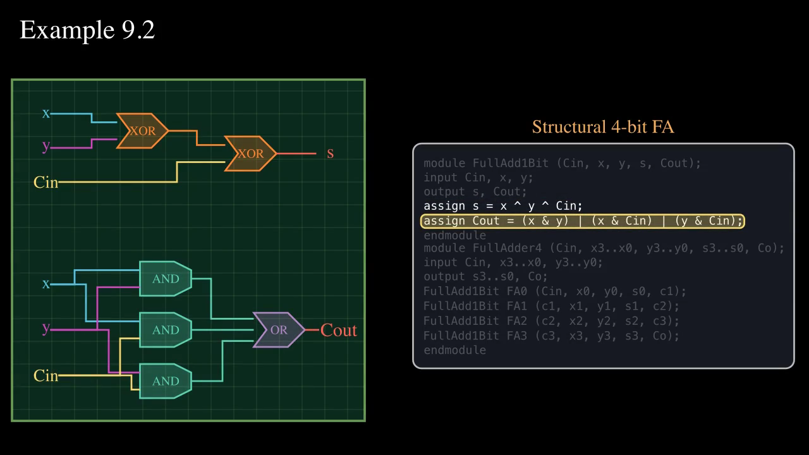
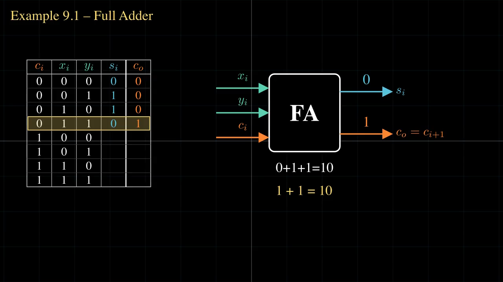
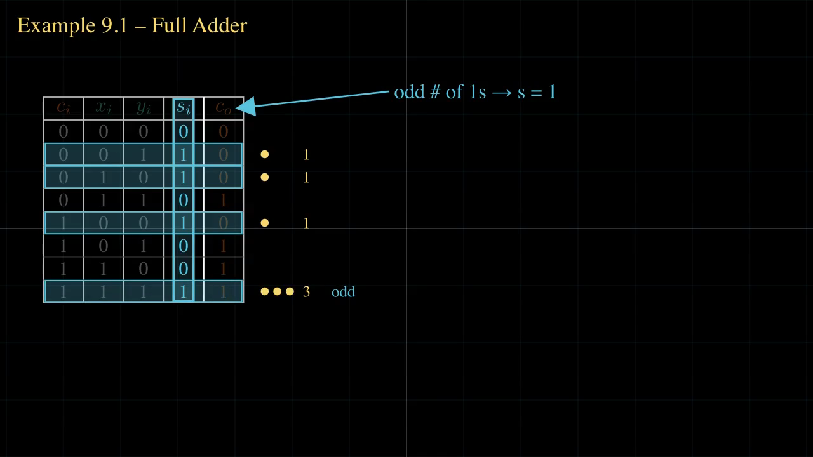
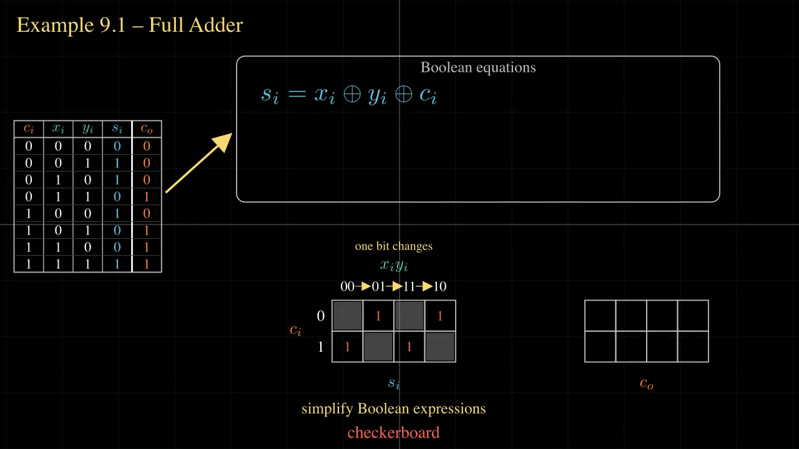
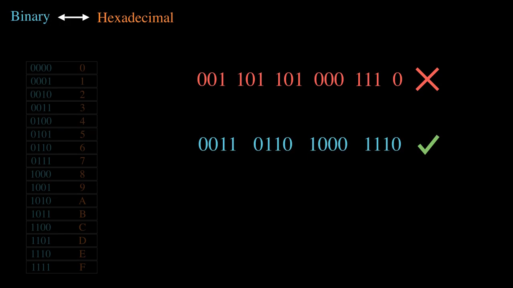
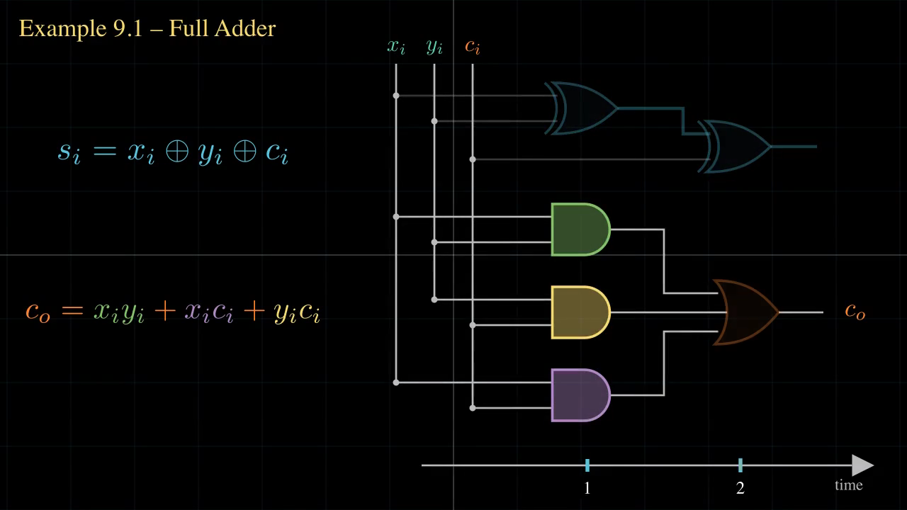
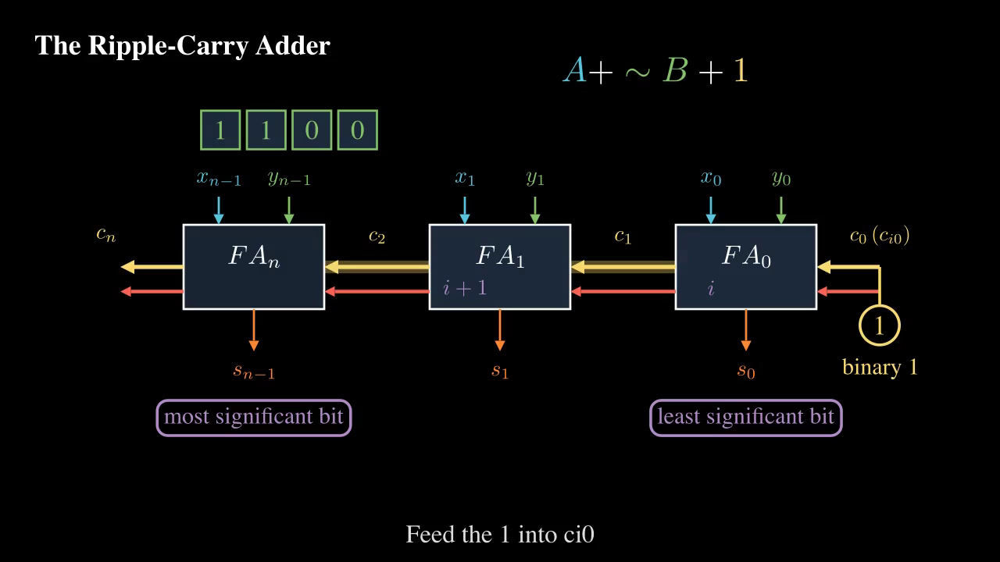

# Lectra

**Turn a PDF, slide deck or set of notes into a narrated, 3Blue1Brown-style animated lecture video.**

Lectra has NotebookLM read your material aloud as a two-host "Audio Overview", transcribes every word with timestamps, works out what the narrator is explaining moment by moment, writes a [Manim](https://www.manim.community/) animation for each slide, and stitches it all into one video over the original audio.



<sub>Frame from a 58-minute lecture Lectra generated from a one-page worksheet on binary adders. The highlighted Verilog line is the one the narrator is reading at that moment.</sub>

---

## What the output looks like

The result is a single `lecture.mp4` (1280×720 at the default quality): a dark-canvas animation that builds up in step with the narration. The audio is treated as the source of truth, so the visuals show what the hosts are saying when they say it.

### The visuals follow the narrator

Three moments from one slide, about four minutes apart. Each caption is the beat Lectra found in the transcript at that timestamp:

| 27:20 | 28:58 | 31:33 |
| :---: | :---: | :---: |
|  |  |  |
| *"Row 4: 011 gives the first carry"* | *"Sum is 1 for an odd number of ones"* | *"Ones form a checkerboard"* (a Karnaugh map) |

### More frames from the same video

| | |
| :---: | :---: |
|  |  |
| Binary → hex: why you group bits by four | Equations turned into gates |


<p align="center"><em>Ripple-carry adder, set up for subtraction (A + ~B + 1)</em></p>

---

## How it works

```mermaid
flowchart LR
    A[PDF / PPTX / notes] -->|Brave + Playwright| B[NotebookLM<br/>Audio Overview]
    B --> C[mlx-whisper<br/>words.json]
    C --> D[Align speech to slides<br/>timeline.json]
    D -->|claude -p| E[Per-idea beats<br/>beats.json]
    E -->|claude -p| F[Manim scene per slide<br/>scenes/*.py]
    F --> G[Render + fill sparse scenes<br/>clips/*.mp4]
    G --> H[Concatenate + mux audio<br/>lecture.mp4]
```



1. **Podcast.** Lectra drives a dedicated Brave profile to upload your sources to NotebookLM, select only those sources, request an Audio Overview (with your focus prompt and length), wait for it, and download it.
2. **Transcribe.** `mlx-whisper` (large-v3-turbo) produces word-level timestamps.
3. **Align.** Each stretch of speech is assigned to the slide (or outline section) being discussed.
4. **Beats.** Claude reads the transcript per slide and lists every idea the narrator introduces, with a timestamp and what to show.
5. **Scenes.** Claude writes one Manim scene per slide, timed to those beats. A scene that fails to render is sent back for repair, up to two times.
6. **Render.** Manim renders each scene and fits it to the slide's audio duration. Scenes that come out mostly empty are densified once.
7. **Mux.** Clips are concatenated and laid over the original audio.

Every stage writes its artifact to disk and is skipped on the next run if that file already exists. You can hand-edit `timeline.json` or a scene file and re-run, or delete one artifact to redo just that stage.

---

## Requirements

- **macOS on Apple Silicon.** Transcription uses `mlx-whisper`.
- **Python 3.11+**
- **ffmpeg** and **ffprobe** on your `PATH`
- **LaTeX** (e.g. [MacTeX](https://www.tug.org/mactex/)). Manim needs it for equations.
- **[Brave Browser](https://brave.com/)** at `/Applications/Brave Browser.app`
- **[Claude Code](https://claude.com/claude-code)** CLI (`claude`), signed in. Used headless (`claude -p`) to write beats and scenes.
- A Google account with access to NotebookLM

## Install

```bash
git clone <this repo> lectra && cd lectra
python3 -m venv .venv
.venv/bin/pip install -r requirements.txt
```

The first transcription downloads the Whisper model (~1.6 GB).

## One-time setup

1. **Sign in to Google in Lectra's Brave profile.** Lectra keeps its own profile in `~/.lectra/brave-profile`. Run any podcast or notebook command once with `--headed`, sign in in the window that opens, then close it. Later runs are headless and reuse the session.

   ```bash
   PYTHONPATH=src .venv/bin/python -m lectra.notebooks --headed list
   ```

2. **Choose a default notebook.** Use a scratch notebook, not one you care about: Lectra uploads sources into it and adds Audio Overviews.

   ```bash
   # make a fresh one and set it as the default
   PYTHONPATH=src .venv/bin/python -m lectra.notebooks create --title "Lectra scratch" --set-default
   # or point at an existing one
   echo 'https://notebook.google.com/notebook/<id>' > ~/.lectra/notebook_url
   ```

3. **Sign in to Claude Code:** `claude auth login`

---

## Usage

### Source material → finished video (one command)

```bash
PYTHONPATH=src .venv/bin/python -m lectra.lecture slides.pdf \
  --out-dir ./my_lecture --length Default
```

| Option | What it does |
| --- | --- |
| `sources...` | One or more `.pdf`, `.pptx` or `.md` files. **The first one is also the slide source.** |
| `--length Short\|Default\|Long` | Podcast length: about 6 min, 15–20 min, or 40+ min. |
| `--focus-file focus.txt` | Custom instructions for the AI hosts (e.g. "cover every slide in order, no analogies"). |
| `--quality low\|medium\|high` | Manim render quality. `medium` (720p) is the default. |
| `--new-notebook` | Create a fresh NotebookLM notebook for this run instead of using the default. Add `--notebook-title "..."` to name it. |
| `--notebook-url URL` | Use a specific existing notebook. |
| `--headed` | Show the Brave window. |

**Papers, code or notes without slides:** write an `outline.md` with one `# Heading` and a one- or two-line summary per section. Each heading becomes one video section. Pass it first, followed by the real source files:

```bash
PYTHONPATH=src .venv/bin/python -m lectra.lecture outline.md paper.pdf --out-dir ./paper_video --length Short
```

Expect roughly **one minute of rendering per minute of video** at medium quality. Long runs are best started in the background, with an eye on the log.

### Already have the audio?

Skip NotebookLM and animate an existing recording of a deck:

```bash
PYTHONPATH=src .venv/bin/python -m lectra slides.pptx narration.m4a --out-dir ./build
```

### Just the podcast

```bash
PYTHONPATH=src .venv/bin/python -m lectra.podcast slides.pdf --length Long --output-dir ./audio
```

### Managing notebooks

```bash
PYTHONPATH=src .venv/bin/python -m lectra.notebooks list            # title, sources, date, URL
PYTHONPATH=src .venv/bin/python -m lectra.notebooks list --json
PYTHONPATH=src .venv/bin/python -m lectra.notebooks create --title "CS 101 Lecture 3" [--set-default]
```

---

## The output folder

```text
my_lecture/
├── audio/
│   └── <Podcast title>.m4a     # the NotebookLM Audio Overview
├── notebook_url                # only with --new-notebook; lets a re-run reuse that notebook
└── build/
    ├── words.json              # every spoken word with start/end times
    ├── timeline.json           # which slide is on screen when
    ├── beats.json              # each idea the narrator introduces, and what to draw for it
    ├── scenes/slide_NN.py      # generated Manim code, one file per slide (editable)
    ├── clips/slide_NN.mp4      # rendered, duration-fitted clip per slide
    └── lecture.mp4             # ← the finished video
```

A single entry in `beats.json` looks like this:

```json
{
  "time": 1631.3,
  "phrase": "Row 4: 011 gives first carry",
  "visual": "Row 4 highlights; a 1+1=10 mini-sum appears and the co cell flashes 1."
}
```

To redo part of a lecture, delete that stage's artifact and run the same command again. For example, delete `scenes/` and `clips/` to regenerate all visuals while keeping the audio and transcript.

---

## Checking the result

The generated code is good but not flawless. Before sharing a video:

- Compare `ffprobe` durations: `lecture.mp4` should match the audio.
- Pull a few frames from the middle and end of several scenes and look for overlapping text, clipped content or near-empty frames.
- Search `words.json` for any number or name shown on screen. Flag anything the narrator never actually said.

## Tests

```bash
.venv/bin/python -m pytest -m "not slow"   # fast suite
.venv/bin/python -m pytest                 # includes a real Whisper transcription
```

## Limitations

- macOS + Apple Silicon only (mlx-whisper), and the Brave path is hard-coded.
- The NotebookLM steps automate its web UI. When Google changes that UI, the selectors in `podcast.py` (notebook page) and `notebooks.py` (home page) need updating. All UI knowledge is kept in those two files.
- NotebookLM limits how many Audio Overviews you can generate per day.
- Short podcasts skim. Sections the hosts skip get only a few seconds of video, so use `Default` or `Long` for full coverage.
